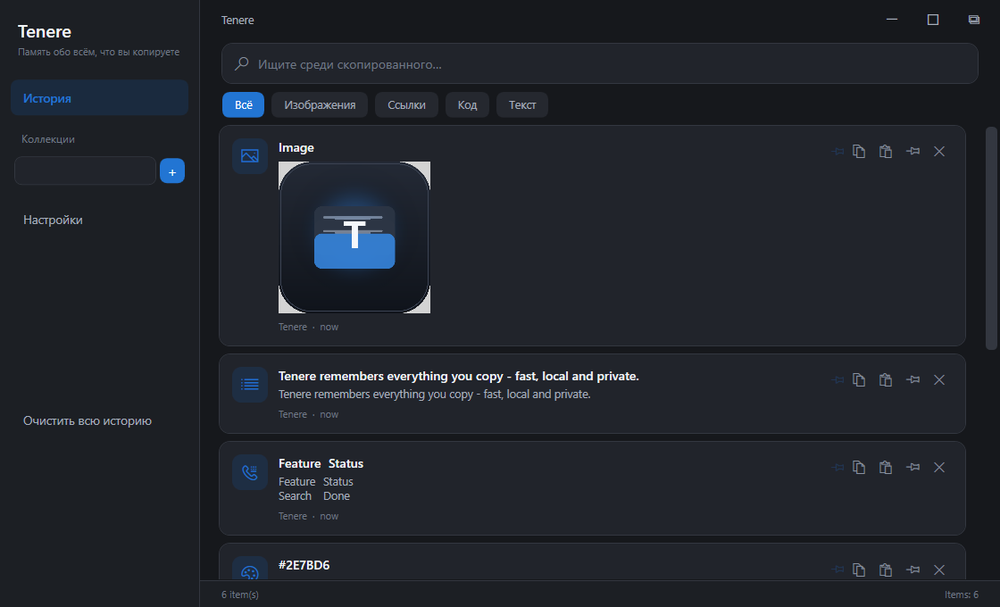

# Tenere

**Память обо всём, что вы копируете.**

[English](README.md) · [Русский](README.ru.md)

Tenere — локальный менеджер буфера обмена для Windows. Он сохраняет всё скопированное, показывает визуальную историю, находит текст на старых скриншотах через локальный OCR, преобразует содержимое перед вставкой и по умолчанию не пускает секреты в историю.

Без аккаунта. Без облака. Без телеметрии.

## Возможности

- **История буфера** — текст, ссылки, код, изображения, таблицы, цвета и файлы с указанием приложения-источника и времени.
- **Визуальная память** — переключение между компактным списком и сеткой карточек с превью.
- **Мгновенный поиск** — по тексту, OCR-тексту, приложению, тегам и дате.
- **Локальный OCR** — Windows Media OCR распознаёт текст на скопированных изображениях. Данные не уходят с устройства.
- **Умная вставка** — цепочки преобразований: убрать форматирование, очистить URL, форматировать JSON, преобразовать таблицу в Markdown, своё регулярное выражение.
- **Контекстная вставка** — правила для отдельных приложений. В Word сохранить форматирование, в терминале вставить чистый текст.
- **Коллекции** — закрепление, теги, импорт и экспорт.
- **Privacy Shield** — исключения менеджеров паролей из коробки, обнаружение токенов и ключей, ручные исключения, срок хранения и очистка одним действием.

## Почему Tenere

- **Приватность по умолчанию.** История не покидает компьютер. Содержимое буфера никогда не пишется в логи.
- **Лёгкость.** Цель по RAM в простое — 25–50 МБ при почти нулевом CPU. Замеры делает реальный benchmark.
- **Нативность.** C# и WPF на .NET 10, а не обёртка Electron.
- **Скорость.** Глобальная горячая клавиша мгновенно открывает историю, поиск работает по мере ввода.

## Установка

Скачайте установщик или portable-сборку со страницы [Releases](https://github.com/Therealwh/tenere/releases).

Подробности — в [docs/INSTALLATION.md](docs/INSTALLATION.md).

## Приватность

Tenere работает полностью офлайн. Он не создаёт аккаунты, не отправляет буфер обмена во внешние сервисы и не включает телеметрию. Обновление запускается только по кнопке «Check for updates» и проверяет SHA-256 перед установкой.

Полная модель — в [docs/PRIVACY.md](docs/PRIVACY.md).

## Технологии

C# · .NET 10 LTS · WPF · SQLite с FTS5 · Windows Media OCR · Win32 clipboard API · Inno Setup

Замеры — в [docs/BENCHMARKS.md](docs/BENCHMARKS.md).

## Дорожная карта

[ROADMAP.md](ROADMAP.md) и [docs/ARCHITECTURE.md](docs/ARCHITECTURE.md).

## Участие

Приветствуется. Перед PR прочитайте [CONTRIBUTING.md](CONTRIBUTING.md).

## Лицензия

[MIT](LICENSE)

Демо-GIF будет добавлено к первому публичному релизу.